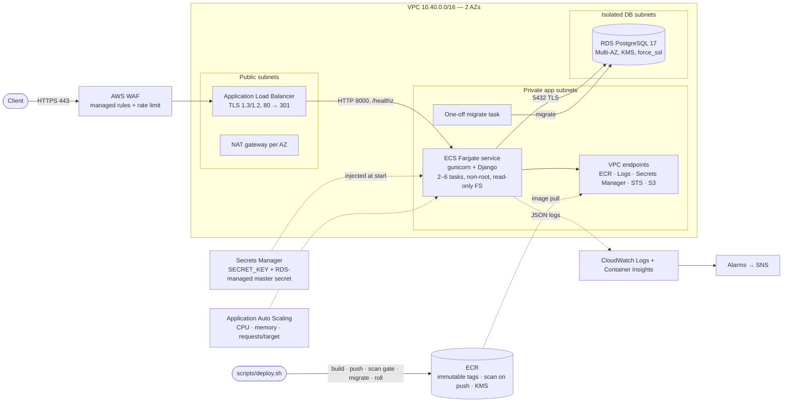

# Django on ECS Fargate — Delivery Platform

A production-style delivery platform for a Django service on AWS: a hardened container
image in **Amazon ECR**, running on **ECS Fargate** behind an **Application Load Balancer**
with **AWS WAF**, backed by **RDS PostgreSQL**, with secrets in **AWS Secrets Manager**,
logs and alarms in **CloudWatch**, and target-tracking **autoscaling**. Everything is
defined in **Terraform**, checked offline (mocked `terraform test`, Checkov, hadolint,
ShellCheck, actionlint, pytest), and runs end to end on a laptop with **Docker Compose**.

The workload is *Release Ledger*, a small Django 6.1 app that records which version of
each service is deployed to dev, staging and prod (HTML dashboard + read-only JSON API +
Django admin).

> Status: infrastructure is code-complete and verified offline. Nothing in this repo has
> been applied to an AWS account, and GitHub Actions is disabled for this repository.

---

## Architecture



Request path: client → WAF → ALB (TLS terminates here) → Fargate task on port 8000 →
PostgreSQL over TLS. Tasks have no public IPs; the database subnets have no route to the
internet at all.

## What's in the repo

| Path | What it does |
|---|---|
| `app/` | Django 6.1 project (`config/`) and the `ledger` app. 12-factor settings from env, WhiteNoise static files, JSON logging, gunicorn config, container healthcheck. |
| `app/config/health.py` | `/healthz` (liveness) and `/readyz` (DB check) answered *before* host validation and SSL redirect, so ALB probes work while `ALLOWED_HOSTS` and `SECURE_SSL_REDIRECT` stay strict for real traffic. |
| `Dockerfile` | Multi-stage build on a digest-pinned `python:3.13-slim-trixie`, venv copied into a slim runtime, uid 10001, `collectstatic` at build time, `HEALTHCHECK`. |
| `compose.yaml` | PostgreSQL 17 + one-shot `migrate` (runs migrations and seeds demo data) + `web`; read-only root FS, `cap_drop: ALL`, `no-new-privileges`, loopback-only port. |
| `terraform/modules/network` | VPC, public / app / isolated DB subnets per AZ, NAT per AZ (or single), interface + S3 gateway endpoints, locked default SG, KMS-encrypted flow logs. |
| `terraform/modules/ecr` | Repository with immutable tags, scan on push, KMS encryption, lifecycle rules (untagged after 7 days, keep newest 30 tagged). |
| `terraform/modules/database` | RDS PostgreSQL with `manage_master_user_password` (RDS owns and rotates the password in Secrets Manager), KMS, Multi-AZ, `rds.force_ssl`, query logging, Performance Insights, enhanced monitoring, deletion protection, final snapshot. |
| `terraform/modules/ecs_service` | Cluster (Container Insights enhanced), web + migrate task definitions, service with circuit-breaker rollback, ALB + HTTPS listener + redirect, access-log bucket, WAF with logging, 3 target-tracking policies, least-privilege execution role and an empty task role. |
| `terraform/stack` | Root module wiring it together, plus KMS key, chained security groups, Django secret, SNS + 5 CloudWatch alarms, and `tests/guardrails.tftest.hcl` (mocked providers). |
| `scripts/deploy.sh` | Build → push → ECR scan gate → register new task-definition revisions → run migrations as a one-off task → rolling update → wait for steady state. **Dry-run by default.** |
| `scripts/compose-smoke.sh` | Builds the image locally and probes the running compose stack (health, readiness against Postgres, API, static assets, host validation, uid, read-only FS). |
| `scripts/check-all.sh` | Every offline check in one go. |
| `.github/workflows/ci.yml` | Lint, tests, Terraform checks, Checkov, hadolint and a local build + compose smoke test. Never pushes images. |

## Design decisions

- **Secrets never touch the image or plain env.** ECS injects `DJANGO_SECRET_KEY` from
  Secrets Manager and `DB_USER` / `DB_PASSWORD` straight from the RDS-managed master secret
  (`<arn>:username::`). The execution role can read exactly those two secret ARNs.
- **Two IAM roles.** The execution role pulls from one ECR repo, writes to one log group,
  reads two secrets and decrypts via KMS only through Secrets Manager/ECR. The task role
  (the Django process) has no permissions.
- **Immutable, SHA-tagged images.** `image_tag` must be a git SHA; Terraform rejects
  `latest`. The deploy script refuses to ship an image with CRITICAL scan findings.
- **Migrations are a separate task**, run once per deploy before the rolling update, not in
  the web container's entrypoint, so scaling out never races schema changes.
- **Self-healing rollouts.** Min healthy 100% / max 200%, ALB health checks on `/healthz`,
  container health checks, and the ECS deployment circuit breaker with automatic rollback.
- **Timeouts line up.** gunicorn `keepalive` (75s) > ALB idle timeout (60s) to avoid 502s;
  gunicorn `graceful_timeout` (25s) < ECS `stopTimeout` (30s) so requests drain.
- **Terraform and the deploy script don't fight.** The service ignores `task_definition`
  and `desired_count` changes; the script owns image rollouts and autoscaling owns counts.

## Prerequisites

- Python 3.12+ (3.13 used here), Docker with Compose v2.24+
- Terraform ≥ 1.6 (tested with 1.9.8), Checkov, hadolint, actionlint (for `make check`)
- For a real deployment later: AWS CLI v2, `jq`, an AWS account, a domain and an ACM
  certificate in the target region

## Run it locally

```bash
git clone https://github.com/shubhamkhedkar/django-ecs-fargate-delivery-platform.git
cd django-ecs-fargate-delivery-platform

# Option A — full stack in containers (Postgres + migrations + gunicorn)
cp .env.example .env            # optional overrides
docker compose up --build
open http://127.0.0.1:8000/     # dashboard
curl http://127.0.0.1:8000/readyz
curl http://127.0.0.1:8000/api/releases/?environment=prod

# Option B — plain Python with SQLite
make venv
make run                        # DEBUG=true, seeds demo data, runserver on :8000
```

Create an admin user for `/admin/`:

```bash
docker compose run --rm migrate python manage.py createsuperuser
```

Automated end-to-end check of the compose stack (builds locally, never pushes):

```bash
make smoke
```

### Endpoints

| Path | Purpose |
|---|---|
| `/` | Dashboard: current version per environment + recent releases |
| `/api/releases/` | JSON list, filters `environment`, `service`, `limit` (1–200) |
| `/api/releases/current/` | Latest successful release per service per environment |
| `/version` | Build info (`APP_VERSION`, `GIT_SHA`, environment) |
| `/healthz` | Liveness, no dependencies (ALB + container health checks) |
| `/readyz` | Readiness, checks the database (503 when unavailable) |
| `/admin/` | Django admin (path configurable via `DJANGO_ADMIN_URL`) |

### Configuration

| Variable | Default | Notes |
|---|---|---|
| `DJANGO_SECRET_KEY` | — | Required unless `DJANGO_DEBUG=true` |
| `DJANGO_DEBUG` | `false` | |
| `DJANGO_ALLOWED_HOSTS` | `localhost,127.0.0.1` | Comma-separated |
| `DJANGO_CSRF_TRUSTED_ORIGINS` | — | e.g. `https://ledger.example.com` |
| `DJANGO_SECURE_SSL_REDIRECT` / `DJANGO_SECURE_COOKIES` | `!DEBUG` | Off for plain-HTTP local runs |
| `DJANGO_HSTS_SECONDS` | `31536000` (prod) | `DJANGO_HSTS_PRELOAD` is opt-in |
| `DB_HOST`, `DB_PORT`, `DB_NAME`, `DB_USER`, `DB_PASSWORD`, `DB_SSLMODE` | SQLite if `DB_HOST` unset | `DB_SSLMODE=require` by default |
| `WEB_CONCURRENCY`, `GUNICORN_THREADS`, `GUNICORN_TIMEOUT` | 2×CPU+1 (≤4), 4, 30 | |

## Verify offline

```bash
make venv
make check        # ruff, Django deploy checks, pytest, pip-audit, yamllint, ShellCheck,
                  # hadolint, actionlint, terraform fmt/validate/test, Checkov
make tf-test      # just the mocked Terraform guardrail tests
make deploy-dry-run
```

The Terraform tests use `mock_provider` blocks, so they need no AWS credentials and create
nothing. They assert things like: ECR is immutable/scanned/KMS-encrypted; tasks run as
`10001:10001` with a read-only root FS and get secrets only via `secrets`; the execution
role is scoped to two concrete secret ARNs; tasks have no public IP; the circuit breaker
rolls back; RDS is private, encrypted, Multi-AZ and TLS-only; the ALB uses the TLS 1.3
policy and port 80 only redirects; and invalid inputs (`image_tag = "latest"`, a non-ACM
certificate, an unknown environment) are rejected.

## Deploy it to your own AWS account (later)

These steps create billable resources (NAT gateways, ALB, RDS Multi-AZ, Fargate tasks,
WAF). Use the cost levers in `terraform.tfvars.example` for a non-production copy.

1. **State backend.** Create an S3 bucket for state and uncomment the `backend "s3"` block
   in `terraform/stack/versions.tf`.
2. **Certificate.** Request/validate an ACM certificate for your hostname in the target
   region (default `ap-south-1`).
3. **Variables.** `cp terraform/stack/terraform.tfvars.example terraform/stack/terraform.tfvars`
   and set `app_domain`, `certificate_arn` and `image_tag` (the short SHA you will push).
4. **Create the registry first** so there is somewhere to push:
   ```bash
   cd terraform/stack
   terraform init
   terraform apply -target=module.ecr
   ```
5. **Push the first image** (from the repo root; `docker buildx` with `--platform` if you
   build on Apple Silicon):
   ```bash
   REPO=$(terraform -chdir=terraform/stack output -raw ecr_repository_url)
   TAG=$(git rev-parse --short=12 HEAD)
   aws ecr get-login-password | docker login --username AWS --password-stdin "${REPO%%/*}"
   docker build --platform linux/amd64 --build-arg GIT_SHA=$TAG -t "$REPO:$TAG" .
   docker push "$REPO:$TAG"
   ```
6. **Apply the rest** with `image_tag = "<that TAG>"`: `terraform plan` then `terraform apply`.
7. **Run the first migration** with `scripts/deploy.sh --apply` (below), or run the
   `*-migrate` task definition once from the console/CLI.
8. **DNS.** Point a CNAME/alias for `app_domain` at the `alb_dns_name` output.
9. **Every later release:**
   ```bash
   scripts/deploy.sh                                   # dry-run: review the plan
   EXPECTED_ACCOUNT_ID=<your-account-id> scripts/deploy.sh --apply
   ```
   The script refuses to run if your credentials point at a different account.

**Rollback:** the circuit breaker rolls back failed deployments automatically. For a manual
rollback, `aws ecs update-service --cluster <c> --service web --task-definition <previous-arn>`
(the script prints the previous ARN before each rollout).

**Rotating the Django secret key:** put a new value in the `<name>/django-secret-key`
secret, then force a new deployment (`aws ecs update-service --force-new-deployment ...`).
Existing sessions are signed out, which is why rotation is a deliberate step rather than
an automatic schedule.

## Limitations

- Not applied to AWS from this repo; the mocked tests prove wiring and guardrails, not
  real-world behaviour such as ACM validation, quotas or WAF false positives.
- Single region, single service. No CloudFront/S3 for static assets (WhiteNoise serves them
  from the image, which is fine at this scale).
- `random_password` for the Django key lands in Terraform state; keep state encrypted and
  access-controlled.
- ECS Exec is off by default. Enable `enable_execute_command` and add `ssmmessages:*` to the
  task role only if you need shell access.
- The CI workflow is included for reference; Actions is disabled on this repository.

## Cleanup

Local:

```bash
docker compose down -v
docker image rm release-ledger:local
```

AWS (if you deployed it): set `deletion_protection = false`, `terraform apply`, then
`terraform destroy`. RDS keeps a final snapshot (`<name>-final`) and the ALB log bucket is
not force-deleted, so remove those manually once you no longer need them.

## Credits

Based on the scenario in
[NotHarshhaa/DevOps-Projects — DevOps-Project-04](https://github.com/NotHarshhaa/DevOps-Projects/tree/master/DevOps-Project-04)
(Django on AWS ECS and ECR). This repository is an independent implementation with its own
application, Terraform, tests and tooling.

## License

MIT — see [LICENSE](LICENSE).
